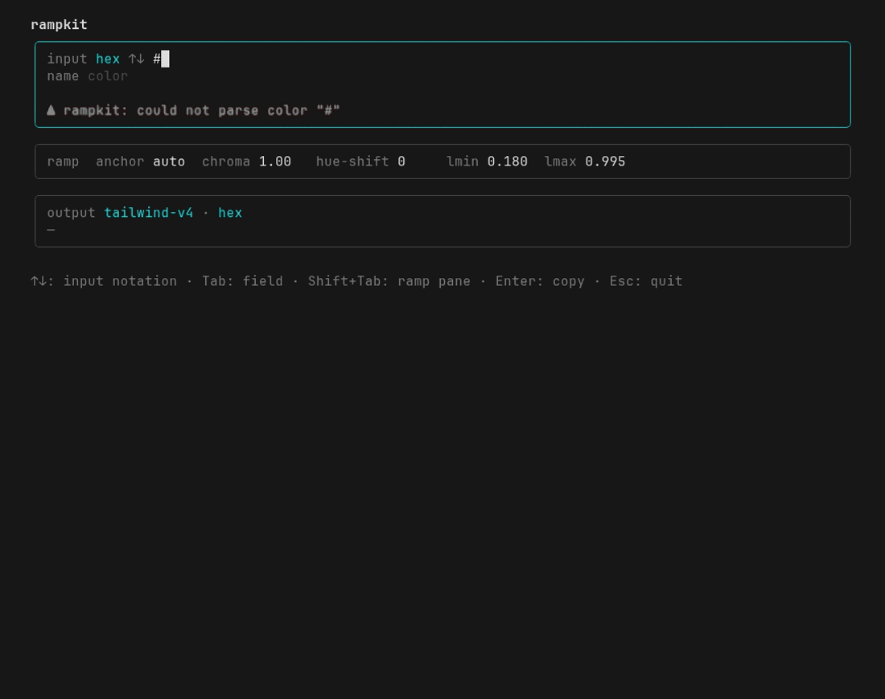

# rampkit

Generate Tailwind-style color ramps (`50`–`950`) from a single input color — the
exact input is preserved at its natural stop — and emit the result in several
output formats, not just a Tailwind config object.



rampkit ships three ways to use it from one repo:

| Package                                                   | Install                            | Use                                               |
| --------------------------------------------------------- | ---------------------------------- | ------------------------------------------------- |
| **Library** — [`@shbernal/rampkit`](./packages/core)      | `bun add @shbernal/rampkit`        | `import { ramp, format }` in your code            |
| **CLI + TUI** — [`@shbernal/rampkit-cli`](./packages/app) | `bun add -g @shbernal/rampkit-cli` | `rampkit '#451dc7'` (CLI) or bare `rampkit` (TUI) |

## Quick start

```ts
import { ramp, format } from "@shbernal/rampkit";

const scale = ramp("#451dc7"); // { 50: "...", ..., 950: "..." }
format(scale, "tailwind-v4"); // @theme custom properties
```

```bash
rampkit '#451dc7'                # tailwind-v4 @theme (default)
rampkit                          # no args → interactive TUI
```

## Documentation

Full docs live in [`docs/`](./docs):

- [Library API](./docs/library.md) — `ramp()`, `format()`, options, the ansi helper.
- [CLI reference](./docs/cli.md) — flags, formats, stdin/stdout piping.
- [TUI guide](./docs/tui.md) — interactive panes and key bindings.
- [Development](./docs/development.md) — monorepo layout, build/test, regenerating the demo.

## Why

Existing tools each miss something: they're web apps not libraries, support only
one input format, emit only a Tailwind config object, are unmaintained, or aren't
open source. `rampkit` aims to be: maintained, TypeScript, Tailwind v4-aware, an
installable npm package, broad input encodings, and **multi-format output** — all
under a permissive (MIT) license.

## Credit / provenance

The ramp-generation _approach_ is inspired by
[tints.dev](https://tints.dev) by Simeon Griggs (3-anchor lightness distribution
in a perceptual color space, per-stop hue/saturation tweaks, and preserving the
input color at its anchor stop). tints.dev is licensed CC BY-NC 4.0.

**`rampkit` does not copy tints.dev's code.** It is an independent clean-room
reimplementation of the general technique — algorithms and ideas are not
copyrightable — written from scratch and released under MIT so it can be used
freely, including commercially.

## License

[MIT](./LICENSE) © shbernal
