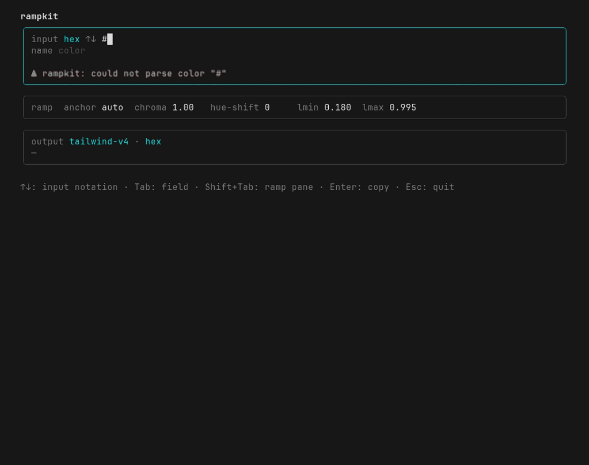

# TUI

Run `rampkit` with no arguments in an interactive terminal.

## Layout

The screen splits into three focusable panes. `Shift+Tab` cycles focus through
them, input to ramp to output.

### Input pane

- `↑`/`↓` cycle the input notation (`hex`, `rgb`, `hsl`, `oklch`), re-expressing
  the same color in each.
- `Tab` cycles the value fields, then the token name field, then back.
- The scale lists each stop's value in the current notation beside its swatch.
  The anchor stop, your exact input, is marked with `*`.

### Ramp pane

The geometry `ramp()` is built from. These are the five values the CLI takes as
flags, so a ramp dialled in here is reproducible as a one-liner.

- `Tab` moves between `anchor`, `chroma`, `hue-shift`, `lmin` and `lmax`.
- `↑`/`↓` adjust the focused one by a step. Up always means more: more chroma,
  more drift, a higher lightness end. For `anchor` it is one stop up the scale
  drawn above, so the arrow and the `*` move together. Past stop 50 it reaches
  `auto`, where the stop follows the input's own lightness.
- `←`/`→` do the same ten steps at a time, for crossing the range. `chroma 8` is
  14 presses instead of 140. Every value they land on is one `↑`/`↓` could have
  reached, so you can mix the two freely.

`hue-shift` wraps at half a turn. Everything else stops at its limit, and the two
lightness ends stop one step short of each other, since a ramp needs `lmin` below
`lmax`.

### Output pane

- `↑`/`↓` cycle the output color syntax (`hex`, `rgb`, `hsl`, `oklch`).
- `Tab` cycles the output format (`tailwind-v4`, `css-vars`, `tailwind-config`,
  `json`, `hex-array`).

## Keys

| Key             | Action                                                                           |
| --------------- | -------------------------------------------------------------------------------- |
| `Shift+Tab`     | Cycle focus: input, ramp, output                                                 |
| `↑`/`↓`         | Input notation (input) / adjust the focused dial (ramp) / output syntax (output) |
| `←`/`→`         | Adjust the focused dial by ten steps (ramp)                                      |
| `Tab`           | Cycle fields (input, ramp) / output format (output)                              |
| `Enter`         | Copy the output to the clipboard                                                 |
| `Esc`, `Ctrl-C` | Quit                                                                             |

## Short terminals

Drawn in full the interface wants about 40 rows: eleven stops, three bordered
panes and an output block. On a shorter terminal the panes you are not in
collapse to one line each, enough to keep reading them. The input pane becomes
its color and a strip of swatches with the anchor still marked; the output pane
becomes its format and how many lines `Enter` would copy. Focus is what expands a
pane again, so `Shift+Tab` is how you get a collapsed one back. An 80x24 terminal
fits whichever pane you are working in, whole.

## Notes

Copying works locally through `pbcopy`, `wl-copy`, `xclip`, `xsel` or `clip`, and
over SSH through the OSC 52 escape, tmux and screen included.

Swatches are painted in 24-bit sRGB. Terminals have no way to render `oklch()` or
wide-gamut color, and every stop is gamut-mapped into sRGB anyway, so the swatch
shows the color the value denotes. When you need the precise value, read the
emitted text, not the block.

The demo above comes from [VHS](https://github.com/charmbracelet/vhs). See
[CONTRIBUTING.md](../CONTRIBUTING.md#regenerating-the-demo) for how to re-render
it.
